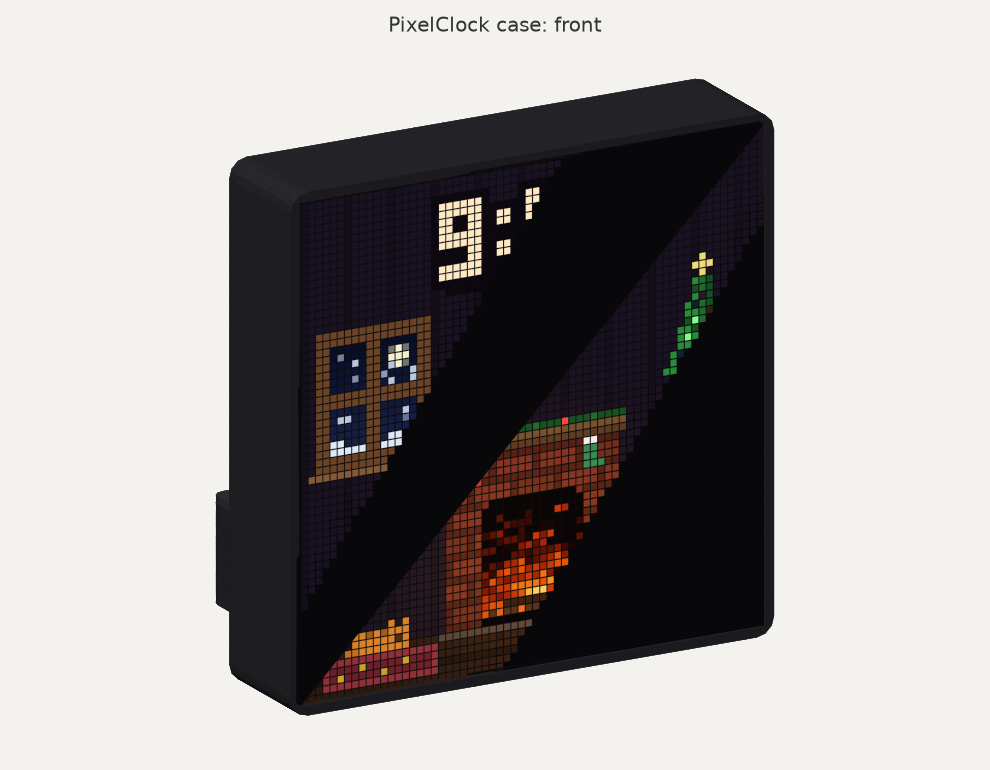
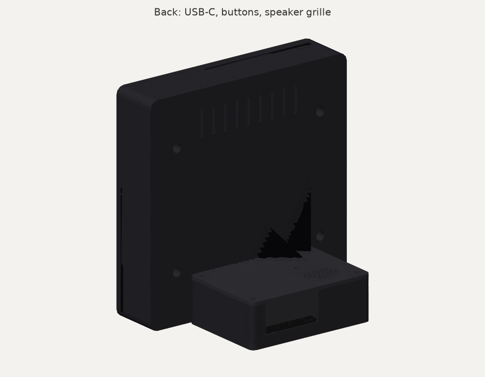
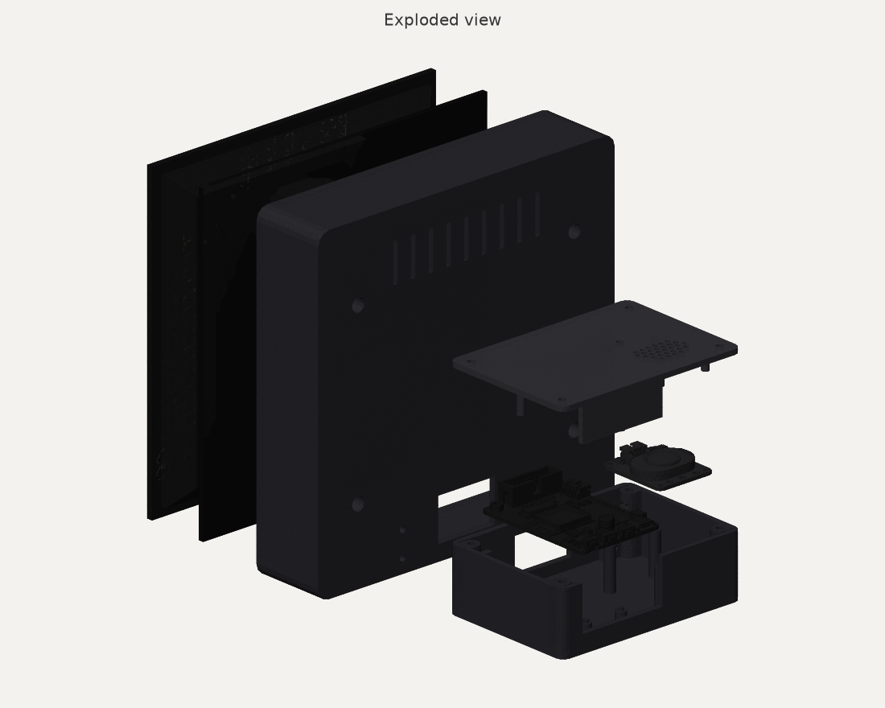

# PixelClock case

A 3D-printable case for the PixelClock. From the front you only see the display in a thin 3.5 mm border. The electronics sit in a foot behind it, and **one USB-C cable** leaves the back.





| | |
|---|---|
| Display size | 167 × 167 mm, 38.6 mm deep (36 mm without the acrylic) |
| Footprint with foot | 167 wide × 110 mm deep |
| Printed parts | 3: display, foot, lid |
| Supports needed | None |

The case is designed for the optional [black LED diffusion acrylic](https://www.adafruit.com/product/4594) (PID 4594). It sits in front of the LEDs, flush with the frame. If you're not using it, print `pixelclock_display_no_acrylic.stl` instead of `pixelclock_display.stl`. That puts the LEDs flush with the frame, and everything else stays the same.

It fits these exact parts:
- Adafruit 64x64 RGB LED Matrix Panel, 2.5 mm pitch, 45° curb-cut ([PID 5407](https://www.adafruit.com/product/5407))
- Adafruit Matrix Portal S3 ([PID 5778](https://www.adafruit.com/product/5778))
- Adafruit STEMMA Speaker ([PID 3885](https://www.adafruit.com/product/3885)) with a JST PH 3-pin plug-plug cable ([PID 4336](https://www.adafruit.com/product/4336))

## What you need

**Hardware:** all of it comes in Adafruit's [Black Nylon Machine Screw and Stand-off Set – M3 Thread](https://www.adafruit.com/product/4685) (PID 4685). Any M3 screws and nuts of the same lengths work too.

| Qty | Part | Used for |
|---|---|---|
| 4 | M3 × 6 mm screw | Panel to display, into the panel's brass inserts |
| 8 | M3 × 10 mm screw | 4 join the foot to the display, 4 hold the lid |
| 8 | M3 hex nut | One for each M3 × 10 screw |

The board and speaker need no screws. They sit on locating pins and the lid clamps them.

**For the acrylic:** thin clear double-sided tape, cut into about 6 small pieces. Any clear tape under 0.5 mm thick works. Adafruit's [diffuser guide](https://learn.adafruit.com/adafruit-matrixportal-s3/led-matrix-diffuser) uses Uglu Dashes, and Adafruit also sells Clear Adhesive Squares. Avoid thick foam tape, because it pushes the acrylic forward out of the frame.

**Cables:** the ribbon cable and power cable that come with the panel, plus the speaker cable.

**Tools:**
- A small Phillips screwdriver with a shaft at least 25 mm long. The panel screws sit at the bottom of 19 mm deep holes.
- A soldering iron, for the one address E solder blob.

## Printing

The STL files in [`stl/`](stl/) are already oriented for printing:

| File | Size on the bed | Orientation |
|---|---|---|
| `pixelclock_display.stl` | 167 × 167 × 38.6 mm | Back face down, front rim up. For use with the acrylic. |
| `pixelclock_display_no_acrylic.stl` | 167 × 167 × 36 mm | Same, for use without the acrylic. Print one display, not both. |
| `pixelclock_foot.stl` | 101 × 71 × 32 mm | Floor down |
| `pixelclock_lid.stl` | 101 × 71 × 23 mm | Top face down, posts up |

You need a print bed of at least 170 × 170 mm.

Suggested settings:
- **Material:** PLA or PETG. Black looks best around the LEDs.
- **Layers and infill:** 0.2 mm layers, 3 walls, 20% infill.
- **Supports:** none. Every overhang is a short bridge.
- **Display part:** the front rim prints as the top surface, so turn on ironing if your slicer has it, for a smooth bezel. A brim helps keep the large display part from lifting at the corners.

## Cutting the acrylic

Skip this if you're printing the no-acrylic display.

- **Size:** cut the 12" × 12" sheet to **160.0 × 160.0 mm**, the same as the panel. The frame opening is 161 mm, so anything from 159.5 to 160.8 mm fits. A sheet any smaller leaves a visible gap.
- **Tools:** a laser cutter gives the cleanest edge, and Adafruit says this acrylic "works great in laser cutters". A table saw or bandsaw with a fine blade also works. Adafruit warns that scoring and snapping is tricky to get straight.
- **Finishing:** peel the paper off both sides. Put the **matte side facing out**, per Adafruit's [diffuser guide](https://learn.adafruit.com/adafruit-matrixportal-s3/led-matrix-diffuser).

## Assembly

1. **Solder the address E jumper** on the bottom of the Matrix Portal: a blob joining the middle pad to the pad marked **8**. Adafruit's [pinouts page](https://learn.adafruit.com/adafruit-matrixportal-s3/pinouts) has a photo.
2. **Peel the amber tape** off the Matrix Portal's two power standoffs. Adafruit says this must be removed.
3. **Put nuts in the foot:**
   - 4 nuts go in the hex pockets on the inside of its front wall.
   - 4 nuts go in the side slots of the corner posts. Push each one all the way in so it lines up with the hole.
4. **Join the foot to the display:**
   - Stand the display upright and set the foot against the bottom of its back.
   - Reach in through the front opening and drive 4 × M3 × 10 screws through the back wall into the foot's nuts.
5. **Wire the Matrix Portal:**
   - Screw the panel power cable's red lug to **+5V** and its black lug to **GND**.
   - Plug the ribbon cable into the board's top 2×8 header.
6. **Seat the board in the foot.** Put its USB-C edge into the slot in the back wall and press its four mounting holes onto the four pins.
7. **Seat the speaker** on its four pins with its connector facing the display. Connect it to the board's **A0** port with the 3-pin cable.
8. **Feed the ribbon and power cable** through the window into the display, then out of the front opening.
9. **Connect the panel:** ribbon into the panel's **input** connector (labelled JIN), power cable into the panel's power connector.
10. **Attach the acrylic**, if you're using it:
    - Put small pieces of clear double-sided tape on the panel's LED face: one at each corner and one halfway along the top and bottom edges. That's Adafruit's pattern.
    - Lay the acrylic on, matte side out, with its edges lined up with the panel's edges, and press it down.
11. **Turn the panel so the input connector is at the bottom.** Seen from the back, the ⇧ arrows printed on the panel's board now point **left**. Fold the cables into the space behind the panel and press the panel, with its acrylic, into the frame.
12. **Screw in the panel.** Lay the clock face-down on a soft towel so the panel stays in place. Drive 4 × M3 × 6 screws through the holes in the back of the display into the panel's inserts. The screws pull the panel back against the screw bosses, and the acrylic then sits flush with the front of the frame.
13. **Close the lid.** Slide its tongue into the slot above the USB port, then fit 4 × M3 × 10 screws into the corner nuts.
14. **Plug in USB-C.** The cable leaves straight out of the back of the foot.

The three buttons poke out of the slot next to the USB port. Seen from the back, closest to the port first, they are:
- **DOWN**
- **UP**
- **RESET**

The small hole in the lid next to the speaker grille reaches the speaker's volume knob with a small screwdriver.

**Firmware:** `PANEL_ROTATION` in [`firmware/src/main.cpp`](../firmware/src/main.cpp) is set to `1` for this case. With the input connector at the bottom, it turns the image upright. If you mount the panel another way, change it to `0`, `2` or `3`.

## How the fit was checked

Every dimension comes from Adafruit's own files ([Sources](#sources)), not from photos or guesses. `check_fit.py` places Adafruit's 3D models of the panel, the Matrix Portal S3 and the speaker inside the case and checks them as solid geometry:

- **Both versions:** everything below was checked with the acrylic (`check_fit.py`) and without it (`check_fit.py --no-acrylic`).
- **Components:** no printed part overlaps any of the 163 solids in the three component models, or the 160 × 160 × 2.6 mm acrylic sheet.
- **Printed parts:** the three printed parts don't overlap each other.
- **Locating pins:** the pins pass cleanly through the mounting holes in Adafruit's board and speaker models.
- **Self-test:** to prove the check isn't blind, it moves parts slightly out of place and confirms each mistake is caught. It tests the board shifted 0.5 mm, the board raised 0.3 mm, the speaker shifted 0.5 mm, the panel shifted 0.6 mm, the panel pushed back 0.3 mm and the acrylic shifted 0.6 mm.
- **Hardware:** true-shape M3 nuts, screw shanks, screw heads and screwdriver access all fit where they go.
- **Cable plugs**, which aren't in the models: the space each one needs is empty, for the speaker plug, the A0 plug, the ribbon plug and its path to the window, and the power lugs.

Key clearances:

| Where | Clearance |
|---|---|
| Panel in the frame | 0.5 mm per side |
| Acrylic in the frame | 0.5 mm per side, front flush with the frame |
| Board header to lid (room for the ribbon plug) | 10.3 mm |
| Under the board (its 2×10 socket) | 1.45 mm |
| Speaker to lid | 1.5 mm |
| USB-C port | 0.37 mm inside the back face, so any plug fits fully |
| Buttons | stick out 0.67 mm past the back face |

**Not checked by software:** what actually comes off your printer. If a part prints slightly large, the panel opening has 0.5 mm per side and the pins have 0.15 to 0.3 mm. The geometry was checked against Adafruit's models only.

## Editing the design

Everything is generated by [`pixelclock_case.py`](pixelclock_case.py), with all dimensions as named constants at the top. To change something, edit it, regenerate, and re-run the check:

```bash
python -m venv case/.venv
case/.venv/Scripts/pip install gmsh numpy matplotlib
case/.venv/Scripts/python case/pixelclock_case.py
case/.venv/Scripts/python case/check_fit.py
case/.venv/Scripts/python case/check_fit.py --no-acrylic
case/.venv/Scripts/python case/render_previews.py
```

- `case/pixelclock_case.py` writes the STLs to [`stl/`](stl/) and editable STEP files to [`step/`](step/), including `pixelclock_case_assembly.step` with all three parts in place. It builds both versions of the display part; the acrylic thickness is `ACRYLIC_T`.
- `case/check_fit.py` downloads Adafruit's reference models into `case/reference/` (not committed) the first time it runs.

## Sources

| Part | Source |
|---|---|
| Panel shape, depth and insert positions | Adafruit's "64x64 RGB Matrix Bevel" model in `Cube_Source_Files.zip` from the [RGB LED Matrix Cube guide](https://learn.adafruit.com/rgb-led-matrix-cube-for-pi/3d-printing). The size is confirmed by the panel's [spec sheet](https://cdn-shop.adafruit.com/product-files/5407/5407_Indoor-P2.5-32S-64x64-SMD2020-4x45_degree.pdf) (160 × 160 mm, 4 sides × 45°). |
| Matrix Portal S3 outline, mounting holes, buttons, connectors | [Adafruit-MatrixPortal-S3-PCB](https://github.com/adafruit/Adafruit-MatrixPortal-S3-PCB) board file, cross-checked against [Adafruit_CAD_Parts/5778 Matrix Portal S3](https://github.com/adafruit/Adafruit_CAD_Parts/tree/main/5778%20Matrix%20Portal%20S3) |
| STEMMA Speaker outline, mounting holes, connector | [Adafruit-STEMMA-Speaker-PCB](https://github.com/adafruit/Adafruit-STEMMA-Speaker-PCB) board file, cross-checked against [Adafruit_CAD_Parts/3885 STEMMA Speaker](https://github.com/adafruit/Adafruit_CAD_Parts/tree/main/3885%20STEMMA%20Speaker) |
| Button names, address E jumper, accelerometer, USB power | [Adafruit MatrixPortal S3 guide](https://learn.adafruit.com/adafruit-matrixportal-s3) |
